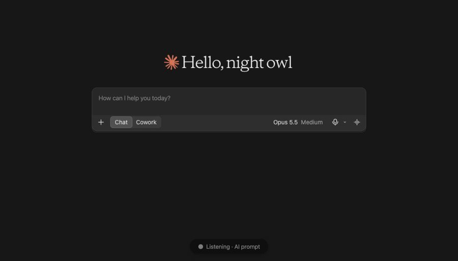

<p align="center"></p>

# Umless

**Local, open-source voice dictation that types what you *meant*, not just what you said.** Hold a key, talk the way you actually talk ("um, can you look at my auth middleware, no wait, the session handler…"), let go, and clean text appears at your cursor.

- **Runs 100% on-device.** Speech recognition, the cleanup LLM and screen reading all run on your Mac. No account, no cloud, no telemetry.
- **Writes for the app you're in.** A concise prompt in Claude, ChatGPT and Cursor; formal in Gmail and Outlook; casual in Slack and WhatsApp.
- **Reads on-screen names to spell them right.** Say "pria" in a thread with Priya in it, and it types Priya.
- **Free and open source.** Apache-2.0, including the fine-tuned model and the training pipeline.

**Requirements:** macOS 13 or later on Apple Silicon, Windows 10 or 11 (x64), or Linux (X11 or Wayland). All three tiers run on every OS, and the tray app types into any app with a hold key (Fn on macOS, Ctrl + Win / Ctrl + Super elsewhere). Reading on-screen text is macOS-only for now, and the Windows and Linux desktop app is newer and less tested ([details](docs/cross-platform.md)). **First install** builds from source and downloads one tier; on an M5 MacBook Air the build took 94 s, and the downloads took 206 s for Lite (643 MB) and 240 s for Standard (1.77 GB), depending on your connection.

Rust · Parakeet-TDT / Whisper via sherpa-onnx · Qwen via llama.cpp (Metal) · a LoRA fine-tuned 0.8B cleanup model ([Hugging Face](https://huggingface.co/jatinbishla/Umless-Lite-0.8B-r3-GGUF)) · macOS Accessibility.

| | **Lite** | **Standard** | **Max** |
|---|---|---|---|
| Speech model | Parakeet-TDT 110M (int8) | Parakeet-TDT 0.6B v3 (int8) | Whisper large-v3-turbo |
| Cleanup model | **Umless-Lite-0.8B r3** (LoRA fine-tune of Qwen3.5-0.8B, Q4_K_M) | Qwen3.5-2B (Q4_K_M) | Qwen3-4B-Instruct-2507 (Q4_K_M) |
| On disk | 678 MB | 1951 MB | 3533 MB |
| **Word error rate, typed text** (11-clip suite) | **5.7%** | **3.6%** | **1.8%** |
| Word error rate, speech model alone | 9.2% | 6.3% | 3.7% |
| Key-up → text, p50 / max (M5 MacBook Air, idle) | 355 / 754 ms¹ | 760 / 1533 ms | 1250 / 3351 ms |
| Languages | English | 25 European | 99, incl. Hindi |

¹ measured with the base 0.8B cleanup model; the fine-tune's prompt is 77 tokens instead of 575 for the same dictation.

Methodology and the full history are in [Benchmarks](#benchmarks) and [docs/benchmarks.md](docs/benchmarks.md); the design is in [ARCHITECTURE.md](ARCHITECTURE.md).

## Install (one command)

Umless runs on **macOS**, **Windows** and **Linux**. Each needs 1–6 GB free (by tier). The macOS app is the most complete; on Windows and Linux everything except reading the screen works, see [docs/cross-platform.md](docs/cross-platform.md).

### macOS

Needs macOS 13 or later and an admin account. On a brand-new Mac, run `xcode-select --install` first: `git clone` needs Apple's command line tools.

```bash
git clone https://github.com/jatinbishla/Umless.git && cd Umless
./install.sh
```

### Windows

Windows 10 or 11 (x64). In PowerShell:

```powershell
git clone https://github.com/jatinbishla/Umless.git; cd Umless
powershell -ExecutionPolicy Bypass -File install.ps1
```

The installer offers to install what's missing with winget (Rust, the Visual Studio C++ build tools, cmake, LLVM), builds Umless, downloads the tier you pick, installs `umless.exe` to `%LOCALAPPDATA%\Programs\Umless` with a Start menu entry, and starts it in the tray. **Hold Ctrl + Win** anywhere, speak, let go; **Ctrl + Win + Alt** is command mode. `UMLESS_HOLD_KEY=right-ctrl` (or `right-alt`, `ctrl+alt`) picks another hold key. No permissions to grant; Windows won't let it type into apps running as administrator.

### Linux

X11 or Wayland; tested on Ubuntu 24.04 in CI. apt, dnf and pacman are supported:

```bash
git clone https://github.com/jatinbishla/Umless.git && cd Umless
./install.sh
sudo usermod -aG input $USER    # once, then log out and back in: lets Umless see the hold key
```

The installer installs the build tools and libraries (GTK 3, WebKitGTK 4.1, ALSA) and the typing tools (wl-clipboard + wtype/ydotool on Wayland, xclip + xdotool on X11), builds Umless, downloads your tier, and installs `~/.local/bin/umless` with an app-menu entry. **Hold Ctrl + Super**, speak, let go; **+ Alt** is command mode. Wayland blocks global keyboard hooks, so Umless reads the keyboard devices directly (hence the `input` group); on X11 it falls back to XRecord without it. On GNOME Wayland, typing uses `ydotool` (start `ydotoold`), and per-app styles fall back to Clean because GNOME doesn't tell apps which window is focused. A server without a desktop can build only the CLI: `cargo build --release -p umless-cli --no-default-features`. GPU offload for the LLM: add `--features vulkan` (or `cuda`, `rocm`) to the build.

### All platforms

The installer builds Umless (installing Rust and cmake first if you don't have them), suggests a tier for your machine, downloads exactly the models that tier needs and, on macOS, adds a local signing certificate to your login keychain (so updates keep their permissions), installs **/Applications/Umless.app** and opens it. Nothing else to clone or download. The app reads its models from this folder's `models/`, so keep the folder where it is (or set `UMLESS_MODELS` before installing). To skip the questions, pass the tier: `./install.sh lite`, `./install.sh standard`, `./install.sh max`, or `./install.sh all`.

| Tier | Download | Best for |
|---|---|---|
| **lite** | ~650 MB | any laptop; fastest (English) |
| **standard** | ~1.8 GB | the default; 25 European languages |
| **max** | ~3.1 GB | most accurate, 99 languages incl. Hindi; wants Apple Silicon / a GPU |

Add or check tiers any time:

```bash
./target/release/umless models install max      # or: lite, standard, all
./target/release/umless models list
```

## Use

**Dictate into any app (macOS):** hold **Fn**, speak, let go, and the cleaned text is typed at your cursor.

`install.sh` already set up the app. After pulling updates or building by hand, rebuild it with:

```bash
scripts/make-signing-cert.sh      # once: a local signing certificate, so updates keep their permissions
scripts/make-app.sh standard      # builds Umless.app and installs it in /Applications
```

Open **Umless** from Applications or Spotlight. It lives in the menu bar (no Dock icon). A pill at the bottom of the screen shows "Listening" while you hold Fn, with a sound at the start and when the text is typed. The menu has **Edit Dictionary…** (names and terms spelled your way, applied as soon as you save) and **Launch at Login**.

The first time, allow Umless under System Settings → Privacy & Security, then quit and reopen it:
- **Input Monitoring**, to see the Fn key.
- **Accessibility**, to type the text.
- **Microphone**, asked automatically.

Also set System Settings → Keyboard → "Press 🌐 key to" → **Do Nothing**, so Fn doesn't open the emoji picker too. Pressing another key while holding Fn (Fn+←, Fn+F5) cancels, so Fn's shortcuts keep working. **Fn + Control is command mode:** say what to write instead of the text itself. With nothing selected, Umless writes at the cursor using what's on screen ("reply saying thanks, I'll send it Thursday" in a Gmail thread). With text selected, it rewrites the selection ("make this more polite", "turn this into bullet points").

**It reads the screen, locally:** while you speak, Umless reads the text around your cursor through Accessibility. It uses it to spell names the way the thread does (you say "pria", it types Priya), to match the conversation's tone (a jokey Teams chat gets casual text, not formal), and as command mode's context. That text never leaves your Mac and is never saved.

**It learns from your fixes:** if you correct a name Umless typed, it adds your spelling to the dictionary. Turn either off in Settings. **It writes for where you are:** an AI prompt in Claude, ChatGPT, Codex, Cursor or a terminal; polished sentences in Mail, Gmail, Outlook and Teams; your own casual voice in Slack, WhatsApp and Messages; plain cleanup everywhere else. Open Umless from the menu bar to see your history, edit your dictionary or fix one style. Your clipboard is restored after each dictation. Models stay loaded; the mic is on only while Fn is held. Log: `~/Library/Logs/Umless.log`.

To remove Umless completely (app, permission entries, history, dictionary, settings, log and signing certificate), run `scripts/uninstall.sh`. Add `--keep-data` to keep your history and dictionary.

From a terminal, `./target/release/umless app` does the same. Grant the permissions to the terminal app instead.

**Try it in the terminal** (speak, then press Enter):

```bash
./target/release/umless listen --tier standard
```

`--tier` works on every command. Other commands (`umless` is `./target/release/umless`; to type just `umless`, run `ln -s "$PWD/target/release/umless" /usr/local/bin/umless`):

| Command | What it does |
|---|---|
| `umless transcribe file.wav` | one-shot transcription of a file |
| `umless stream file.wav` | replays a file as live speech and measures key-up → text latency |
| `umless devices` / `listen --mic "<name>"` | list mics / pick one |
| `umless listen --save recordings/x.wav` | keep the recording for replay benchmarks |
| `umless clean "text"` | runs the cleanup LLM on any text (`--style clean, formal, casual or prompt`) |
| `umless command "reply saying yes" --screen thread.txt` | command mode without the keyboard |
| `umless app` | the Fn-key app, run from a terminal |
| `umless models install <tier>` / `models list` | download or list models |
| `umless bench --show` | runs every clip through every installed tier and compares accuracy, latency, CPU and size (make the clips first with `scripts/make-bench-clips.sh`) |

### Your dictionary

Names, products and jargon get spelled your way on every tier. Put one term per line in a text file and pass it with `--dictionary my-words.txt` (or set `UMLESS_DICTIONARY`), or list a few inline with `--hotwords "SubFlo,Jatin,lien waivers"`:

```
# my-words.txt
Jatin Bishla
SubFlo
lien waivers
```

The speech model usually *hears* a rare name right and only *spells* it wrong ("Subflow", "firman", "Zirodhaa"), so Umless respells near misses that sound the same, before and after the cleanup LLM. When a word keeps coming out as something else, list what you hear after `=`: `Gaurav = Gorov, Barraf`. Ordinary words that merely look similar ("former", "subway") are left alone. `--hotword-boost 1.5` additionally biases the Parakeet speech model (Lite, Standard) toward the terms; above ~2 it starts inventing them.

Benchmark clips: `./scripts/make-bench-clips.sh` (macOS) synthesises 11 clips with references, and `./scripts/record-passages.sh` records *you* reading 6 passages, so `umless bench --clips recordings` tests your real voice.

Tuning flags: `--threads N`, `--step` / `--context` (streaming), `--asr <model dir>` (override the tier's model).

## FAQ

**How is this different from Wispr Flow and macOS's built-in dictation?** macOS dictation transcribes what you said, fillers and false starts included, and doesn't adapt to the app. Wispr Flow cleans up and adapts, but it processes your audio in the cloud and its full version is a paid subscription. Umless does the cleanup and per-app writing locally, with open models you can inspect, swap or fine-tune, and it publishes its benchmarks.

**Does anything leave my Mac?** No. Models are downloaded once (from Hugging Face and the sherpa-onnx GitHub releases); after that, audio, transcripts and the screen text Umless reads stay on your machine. It has no account, no analytics and no network calls while you dictate. History and your dictionary are plain files under `~/Library/Application Support/Umless`.

**Which tier should I pick?** **Standard** for most people: 3.6% word error rate, 760 ms typical key-up → text, 25 European languages. **Lite** if disk or memory is tight (678 MB, English only). **Max** if accuracy matters more than speed or you need Hindi or another non-European language (1.8% word error rate, 1250 ms typical). `./install.sh` suggests one for your machine, and you can add others any time.

**Why build from source? Is there a DMG?** Not yet. A signed, notarised DMG needs an Apple Developer ID, which is on the [roadmap](#roadmap) along with Homebrew. Until then `install.sh` builds it and signs it with a certificate it creates in your login keychain, so macOS keeps the app's permissions across updates.

## How it works

```
 mic ─► ring buffer ─► 16 kHz ─► streaming ASR ───────────► rules ─► cleanup LLM ─► guard ─► typed at cursor
 (cpal, RT-safe)     (resample)  (decodes while you talk)  (fillers,   (style from  (rejects     (clipboard + ⌘V,
                                  + Silero VAD              self-       the app +    invented     clipboard restored)
                                                            corrections,screen text) names/numbers)
                                                            digits, "?")
```

**1. Streaming speech recognition, so key-up is cheap.** Parakeet is an offline model, so Umless runs it in a LocalAgreement-2 loop: every second it re-decodes the uncommitted window (plus 1.5 s of already-committed audio as left context, snapped to a word start) and commits the words two consecutive decodes agree on, ignoring filler flips like "uh"↔"a". At key-up only the short uncommitted tail is left to decode, so latency doesn't grow with how long you spoke (a 62 s take finishes in 85 ms of ASR on Lite). Whisper has no reliable word timestamps, so Max decodes VAD-cut phrases instead, capped at 4 s so the phrase still open at key-up stays small (8 s → 4 s took Max's p50 from 2,911 ms to 1,250 ms, WER 1.5% → 1.8%).

**2. A safety net for lost words.** A decode that starts mid-word can make Parakeet drop seconds of speech for good once the window slides past it. A per-session Silero VAD marks speech as it arrives; at key-up, any stretch VAD heard as speech that no committed word covers is decoded again and spliced back in by timestamp, skipping words already committed and hesitation-only re-decodes. It costs nothing on normal takes (VAD runs while you talk).

**3. Deterministic rules before any model.** Fillers and stammers, explicit self-corrections ("Tuesday, no wait, Wednesday", "at ten. Actually, make it eleven" → the replaced word must be the same kind: day, number, determiner…), spoken numbers to digits ($18,750, 15%, 2:30, +91, while "two blocking bugs" stays words), question marks small models drop, misheard work phrases ("let's sing" → sync, "deploy field" → failed). These run on every tier and are what's typed when a model's output is rejected.

**4. A cleanup LLM that writes for the app you're in.** The focused app (and, in browsers, the site in the window title) picks the style: a concise, structured **prompt** in Claude, ChatGPT, Cursor, Codex or a terminal; **formal** in Mail, Gmail, Outlook, Teams; **casual** in Slack, WhatsApp, Messages; minimal **clean** elsewhere. The conversation's tone can override it (a jokey Teams chat gets casual). llama.cpp runs on Metal with the fixed system prompt's KV state cached and prompt-lookup speculative decoding, which suits cleanup because the output mostly copies its input.

**5. A guard against rewrites that invent things.** Every LLM output is checked against what was said: new names or numbers (with tolerance for things said in pieces: "my sql" → MySQL, "nine one" → 91, "2000-line"), dropped names, answering instead of rewriting (code fences, much longer output), and for plain cleanup, words dropped that weren't taken back. A rejected output falls back to the rules-only text, so the worst case is less polish, never a wrong fact.

**6. Screen context, locally.** While you speak, a thread walks the focused window's Accessibility tree (≤4,000 nodes, 300 ms budget): text before the cursor, the selection, and the visible thread. Names on screen join the dictionary for that dictation ("pria" → Priya, chat senders like "Meera Shah" included), and command mode (Fn + Control) uses the thread as context ("reply saying Thursday at 4 works"). Chromium and Electron build their tree only on request (`AXEnhancedUserInterface` for Chrome, `AXManualAccessibility` for Electron; the first read per app launch waits up to 2.5 s for it, overlapped with speech); in browsers only the page's `AXWebArea` text is kept.

**7. A dictionary that respells, not biases.** Speech models usually hear a rare name right and only spell it wrong, so instead of boosting the decoder (which makes it hallucinate the term), Umless respells near misses that sound alike (a phonetic key plus a per-length edit budget), and exact "heard as" entries handle the rest (`Gaurav = Gorov, Barraf`). If you fix a name Umless typed, it reads the field back and learns your spelling.

**8. The same pipeline on Windows and Linux.** Steps 1–5 and 7 are plain Rust and run unchanged; only the OS layer differs. The hold key is Ctrl + Win / Ctrl + Super (a low-level keyboard hook on Windows; evdev on Linux, since Wayland blocks global hooks, with XRecord as the X11 fallback). Text goes in by clipboard paste (SendInput Ctrl+V; wl-clipboard + wtype/ydotool or xclip + xdotool), with the clipboard restored. The style comes from the focused window's exe name or class and title. The tray icon, window and pill run on tao + wry (WebView2 / WebKitGTK). The LLM uses the CPU by default, or the GPU with `--features vulkan` / `cuda`. Screen context (step 6) and learning from fixes are macOS-only for now; see [docs/cross-platform.md](docs/cross-platform.md).

## Benchmarks

All numbers come from `umless bench`, which replays recordings through the same session code the app uses and scores against two references: what was *said* (ASR WER) and what was *meant* (final WER, with fillers dropped and self-corrections resolved). WER ignores case, punctuation, number formatting and fillers. Reproduce with `scripts/make-bench-clips.sh && ./target/release/umless bench --dictionary bench/dictionary.txt`.

**11-clip suite** (synthesised voices, en-US/en-GB/en-IN accents; dictation with corrections, fast speech, names, jargon, numbers, pauses), final WER (ASR WER):

| Clip | Lite | Standard | Max |
|---|---|---|---|
| dictation (fillers + "no wait") | 7.7% (6.8%) | 5.1% (4.5%) | 2.6% (2.3%) |
| email-gb | 3.1% (2.5%) | 0.0% (7.5%) | 0.0% (0.0%) |
| fast | 10.8% (12.2%) | 4.1% (5.4%) | 5.4% (5.4%) |
| founder-in | 0.0% (4.8%) | 0.0% (9.5%) | 0.0% (0.0%) |
| jargon-gb | 0.0% (9.1%) | 4.5% (4.5%) | 0.0% (0.0%) |
| names-in | 8.0% (16.0%) | 0.0% (16.0%) | 0.0% (12.0%) |
| names-us | 4.2% (25.0%) | 4.2% (12.5%) | 0.0% (16.7%) |
| numbers-in | 0.0% (0.0%) | 16.0% (0.0%) | 0.0% (0.0%) |
| pauses | 4.5% (4.5%) | 4.5% (4.5%) | 4.5% (4.5%) |
| short | 0.0% (0.0%) | 0.0% (0.0%) | 0.0% (0.0%) |
| tech-gb | 12.5% (16.7%) | 0.0% (0.0%) | 0.0% (0.0%) |
| **All** | **5.7% (9.2%)** | **3.6% (6.3%)** | **1.8% (3.7%)** |

The gap between the two numbers is what cleanup buys: names the speech model misspells get fixed by the dictionary and screen context, and resolved self-corrections count as correct only in the final text.

**A real voice** (the author reading five passages on a MacBook Air mic, Indian-English accent, natural restarts included; `scripts/record-passages.sh`, scored with the same generic `bench/dictionary.txt`), final WER (ASR WER):

| Passage | Lite | Standard | Max |
|---|---|---|---|
| founder pitch | 16.2% (12.5%) | 11.2% (12.5%) | 10.0% (15.0%) |
| email with a phrase-level correction | 17.0% (10.8%) | 37.7% (6.2%) | 11.3% (15.4%) |
| tech request | 17.2% (20.3%) | 6.2% (12.5%) | 4.7% (10.9%) |
| Slack update with "no wait" corrections | 10.9% (8.9%) | 2.2% (8.9%) | 8.7% (12.5%) |
| investor list | 6.9% (12.1%) | 3.4% (8.6%) | 8.6% (8.6%) |
| **All** | **14.0% (13.0%)** | **12.0% (9.9%)** | **8.6% (12.7%)** |

Real speech is harder than the synthetic suite, and most of Standard's error is one passage: "Can we get on a call on March third at two thirty pm? Actually, no, let's make it Thursday morning instead", where it keeps both times. Hinglish isn't supported well on any tier yet.

**AI-prompt mode** (12 rambling spoken requests to an AI assistant: debugging, SQL, refactors, regexes, research, emails; tokens counted with `o200k_base`):

| | Rewritten (not fallen back) | Tokens, said → typed |
|---|---|---|
| Standard | 11/12 | 435 → 367 (15.6% fewer) |
| Max | 11/12 | 435 → 375 (13.8% fewer) |

A blind A/B test then sent each raw and each Umless prompt to a separate Claude instance, and a third judged the answer pairs against what the speaker actually asked for: Umless 4 wins, raw 3, 5 ties. **So the win is shorter, cleaner prompts with every requirement intact, not smarter answers.** Strong models already cope with messy speech. Both losses were rewrites that changed meaning ("plus nine one" → "91", "I'll paste the transcript" → "Paste the transcript"), since fixed in the rules and prompt.

**Latency** (key-up → text in the target app, real-time replay, M5 MacBook Air, idle), p50 / max: Lite 355 / 754 ms (base cleanup model), Standard 760 / 1533 ms, Max 1250 / 3351 ms. Max's floor is Whisper running on the CPU.

## Fine-tuning the Lite cleanup model

Lite's job is the hardest: a 0.8B model cleaning up the noisiest transcripts (Parakeet 110M). Few-shot prompting the base Qwen3.5-0.8B needs a 575-token prompt and still misses phrase-level corrections, so I fine-tuned it. The pipeline is one script, [`finetune/lite_cleanup.py`](finetune/lite_cleanup.py), built to run end to end on a free Colab T4 ([notebook](finetune/Umless_Lite_finetune.ipynb)). The weights and model card are on [Hugging Face](https://huggingface.co/jatinbishla/Umless-Lite-0.8B-r3-GGUF), and `./install.sh lite` downloads them.

1. **Targets first, inputs derived.** A teacher (Qwen3-4B-Instruct) writes the *clean* text: messages across 39 everyday themes, spoken AI requests → prompts, dictation → formal mail, and 800 command-mode examples (screen + instruction → reply). The messy input is then generated *from* the target the way speech plus Parakeet-110M corrupts it: fillers, stammers, phrase-level self-corrections, numbers as words, case loss, and Parakeet's typical confusions ("uh" heard as "all"). Targets are exact by construction, and misheard names never appear in inputs, so the model never learns to invent words.
2. **Filters on the teacher**, so bad targets never train: enumerations must stay numbered lists, questions must stay questions, qualifiers ("open source") must survive.
3. **LoRA** (r = 16, α = 32, lr 2e-4, 1.5 epochs, effective batch 32) on the full-attention and linear-attention projections of Qwen3.5's hybrid layers and the MLPs; merged back into the original checkpoint (keeping every non-LM tensor) and quantised to GGUF Q4_K_M for llama.cpp.
4. **Trained on compact prompts:** the fine-tune runs on a 77-token prompt where the base model needs 575 for the same dictation.

| Round | What changed | Final WER (11 clips) | Text suite |
|---|---|---|---|
| Base Qwen3.5-0.8B, few-shot | — | 6.6% | 21/30 |
| r1 | 4,826 synthetic pairs, 71 min on a T4 | 6.9% | 19/30 |
| r2 | phrase-level corrections, contrastive "I'm/like" pairs, formal + prompt styles | 6.3% | 18/30 |
| r3 | command mode, list/question filters, case-loss noise | 6.6% | 20/30 |
| **r3 with today's rules (shipped)** | digits, corrections and "?" rules in front of it | **5.7%** | 23/30 |
| *Base with today's rules, for comparison* | | *5.7%* | *25/30* |

**What the fine-tune did and didn't buy**, measured with the same rules and dictionary:

| | Base Qwen3.5-0.8B | Umless-Lite-0.8B r3 |
|---|---|---|
| Final WER, 11 synthetic clips | 5.7% | 5.7% |
| Final WER, the author's voice (5 passages) | 13.6% | 14.0% |
| ↳ the phrase-level correction passage | 37.7% | **17.0%** |
| Prompt tokens, same dictation | 575 | **77** |
| Cleanup p50 on the author's voice set (same run conditions) | 1079 ms | 986 ms |

It ties the base model on synthetic clips and is slightly behind on my voice overall, but it resolved the phrase-level self-correction the base model didn't, runs on a prompt 498 tokens shorter, and was the best Lite model in hand-checked command-mode tasks (round 2 invented a person in a Gmail reply; round 3 didn't). What it didn't fix: in prompt mode it still flattens "first… second… third" into prose, so Lite keeps plain cleanup in AI apps. Lite loads the newest `Umless-Lite-*-rN.gguf` in `models/`, so a new round is a drop-in file, and an older install that only has the base model keeps working.

## Roadmap

- **Signed DMG and Homebrew install**, so trying Umless doesn't need a Rust build.
- **Screen reading on Windows and Linux** (UI Automation, AT-SPI), so names, tone and command-mode context work there too, and packaged installers (MSI, .deb / Flatpak). See [docs/cross-platform.md](docs/cross-platform.md).
- **GPU Whisper for Max** (whisper.cpp on Metal or a Core ML encoder), to cut Max's CPU-bound floor.
- **Voice commands** beyond command mode: "new line", "delete that", "send".
- **Better Hindi and Hinglish**, including Roman-script output.

## Contributing

Issues and pull requests are welcome. Good first areas: the Windows and Linux layers, more benchmark clips (especially accents and noisy rooms), and new "misheard phrase" rules. Before opening a PR:

```bash
cargo test && cargo clippy --release
scripts/make-bench-clips.sh && ./target/release/umless bench --fast --dictionary bench/dictionary.txt
```

Any change to recognition or cleanup should include the bench table for **all three tiers**, before and after. Your recordings in `recordings/` are gitignored and stay on your machine.

## Layout

| Path | What |
|---|---|
| `crates/umless-audio` | mic capture (real-time safe), 16 kHz resampling, Silero VAD, WAV loading |
| `crates/umless-asr` | `Transcriber` / `Session` traits, Parakeet backends, LocalAgreement streaming committer |
| `crates/umless-models` | the Lite / Standard / Max tiers |
| `crates/umless-llm` | llama.cpp runtime: prefix-state cache, prompt-lookup speculative decoding |
| `crates/umless-cleanup` | rules, LLM prompt, faithfulness guard |
| `crates/umless-eval` | WER and text normalisation for benchmarks |
| `apps/cli` | the `umless` binary (`app`, `listen`, `command`, `clean`, `transcribe`, `stream`, `devices`, `models`, `bench`) |
| `crates/umless-hotkey`, `-insert`, `-context`, `-shell` | the hold key, typing, the focused app, the menu-bar/tray UI (macOS, Windows, Linux) |
| `install.sh` / `install.ps1` | build + model download, by tier (macOS and Linux / Windows) |
| `scripts/` | benchmark clip synthesis and passage recording |

## License

[Apache-2.0](LICENSE). Models keep their own licences (Parakeet: CC-BY-4.0, Whisper: MIT, Qwen3/Qwen3.5: Apache-2.0).

---

If Umless is useful, a star helps others find it.
